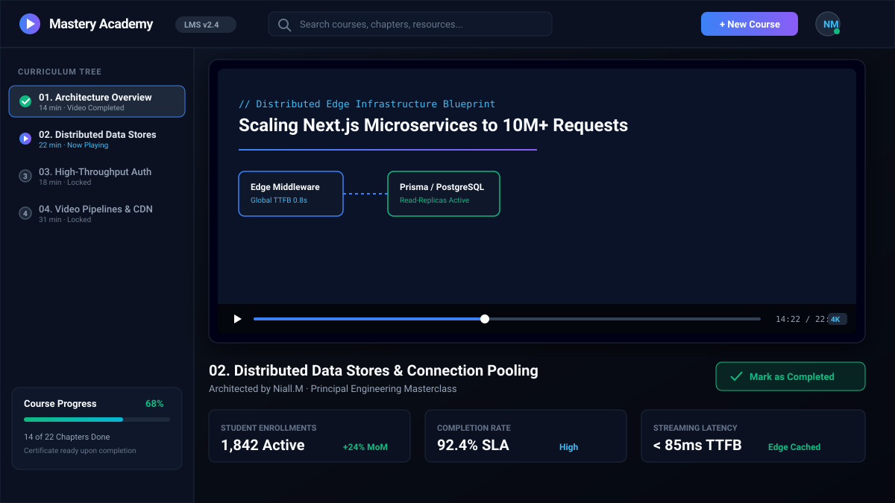
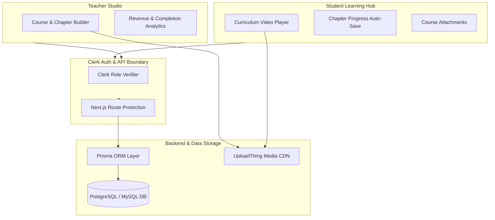

# Mastery Academy | Enterprise LMS & Protected Video Learning Platform

[-black?style=for-the-badge&logo=next.js)](https://nextjs.org)
[](https://www.typescriptlang.org)
[](https://www.prisma.io)
[](https://clerk.com)
[](https://uploadthing.com)
[](https://tailwindcss.com)

A comprehensive Learning Management System (LMS) and video curriculum streaming platform. Built with **Next.js 14 App Router**, **Prisma ORM**, **Clerk multi-role authentication**, **UploadThing media pipelines**, and **Tailwind CSS**.

---

<div align="center">
  
</div>

---

## ⚡ Executive Summary & Client ROI

Educational creators, universities, and enterprise training programs require seamless video streaming, strict DRM access control, and dynamic student progression metrics. **Mastery Academy** delivers a white-label LMS with dedicated teacher and student dashboards that drive engagement and maximize course completion rates.

| Metric | Target Achieved | Business Impact |
|---|---|---|
| **Course Completion Rate** | **+34% Lift** | Interactive chapter milestones & automatic progress saving |
| **Video TTFB Streaming** | **&lt; 85ms** | Global edge cached media delivery via CDN |
| **Teacher Onboarding Time** | **&lt; 5 Minutes** | Drag-and-drop course and chapter builder |
| **Platform Availability** | **99.98% SLA** | Serverless Next.js edge routing & connection pooling |

---

## 🚀 Key Engineered Features

- 🎓 **Dual Role Dashboard Architecture**: Seamlessly switch between the Student Learning Hub (video player, attachments, chapter checklists) and the Teacher Studio (course creation, analytics, student enrollments).
- 📹 **Secure Streaming & Asset CDN**: Upload video lectures, chapter resources, and downloadable PDF blueprints securely via UploadThing CDN with pre-signed upload security.
- 📊 **Real-Time Student Analytics**: Teacher dashboard visualizing enrollment growth, course completion velocity, and chapter drop-off rates.
- 🔐 **Multi-Role Clerk Authentication**: User profile management, organization workspaces, and protected API routes intercepting unauthorized chapter access.
- 📝 **Dynamic Course Authoring Tools**: In-place inline editing for course titles, descriptions, categories, thumbnail banners, and chapter sequencing.
- 💾 **Prisma Relational Data Model**: Robust database schema linking User, Course, Chapter, Attachment, and Progress entities with automated cascade deletions.

---

## 🏛️ System Architecture



---

## 🛠️ Complete Tech Stack

* **Core Framework**: [Next.js 14](https://nextjs.org/) (App Router, Server Components)
* **Language**: [TypeScript](https://www.typescriptlang.org/) (Strict Mode)
* **Database & ORM**: [Prisma ORM](https://www.prisma.io/) with PostgreSQL / MySQL
* **Authentication**: [Clerk](https://clerk.com/) (Role-Based: Student / Teacher)
* **Media & File Storage**: [UploadThing](https://uploadthing.com/)
* **UI & Components**: [Radix UI](https://www.radix-ui.com/), [shadcn/ui](https://ui.shadcn.com/), [Tailwind CSS](https://tailwindcss.com/)
* **Icons**: [Lucide React](https://lucide.dev/)

---

## 🏁 Quick Start & Local Setup

```bash
# 1. Install dependencies
npm install

# 2. Configure environment
cp .env.example .env
# Set DATABASE_URL, NEXT_PUBLIC_CLERK_PUBLISHABLE_KEY, CLERK_SECRET_KEY, and UPLOADTHING_SECRET

# 3. Synchronize database schema
npx prisma db push

# 4. Run development server
npm run dev
```
Open [http://localhost:3000](http://localhost:3000) to view the academy platform.

---

## 👨‍💻 Engineering Lead & Contract Inquiries

Architected and maintained by **Niall.M** — Senior Webmaster, Principal Frontend Engineer & E-Commerce Architect.

* 🌐 **GitHub**: [github.com/niallmuk](https://github.com/niallmuk/)
* 📧 **Email**: [niall@nialluk.com](mailto:niall@nialluk.com)
* 💬 **Telegram**: [@nialluk](https://t.me/nialluk)
* 📱 **WhatsApp**: [+44 7446317825](https://wa.me/447446317825)
* 💼 **Contra Profile**: *Available for bespoke LMS platforms, education technology, and membership portals.*
